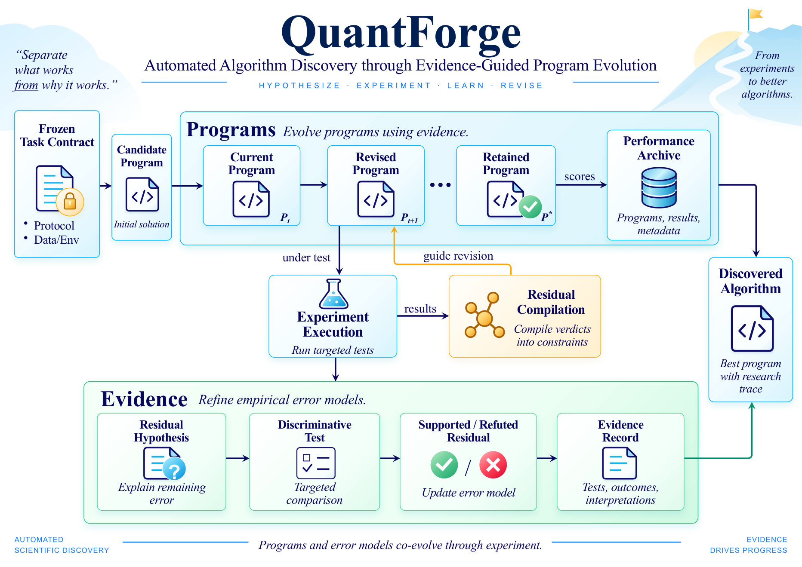

<h1 align="center">QuantForge</h1>

<p align="center">
  <strong>Discovering algorithms through evidence-guided program evolution</strong>
</p>

<p align="center">
  Turn competing explanations into targeted experiments, verified code revisions, and the next algorithmic insight.
</p>

<p align="center">
  <a href="https://arxiv.org/abs/2609.34680"></a>
  <a href="https://www.python.org/"></a>
  <a href="LICENSE"></a>
</p>

<p align="center">
  <a href="https://arxiv.org/abs/2609.34680">Paper</a> ·
  <a href="#how-it-works">How It Works</a> ·
  <a href="#paper-results">Results</a> ·
  <a href="#quick-start">Quick Start</a> ·
  <a href="docs/backends.md">Documentation</a>
</p>

<p align="center">
  Qiulin Shang · Zhoutong Wu · Jie Hu · Kun Yuan<br>
  Peking University
</p>

---

**QuantForge** is a framework for discovering executable algorithms. It combines program evolution with controlled experiments: useful programs are retained by performance, while evidence decides what to change next.

In our [paper](https://arxiv.org/abs/2609.34680), QuantForge discovers **HiRes**, a hierarchical MXFP4 post-training quantization algorithm. Under a matched search budget, it reaches a held-out transfer target in **6 of 8 runs**, compared with **3 of 8** for reflection memory.

<p align="center">
  
</p>

<p align="center"><em>QuantForge retains effective programs while controlled evidence guides their next revision. Figure 1 from the paper.</em></p>

## How It Works

QuantForge builds a search around a simple question: **what should the next program change, and what evidence supports that change?**

1. **Track programs and open questions.** Keep an executable frontier of useful candidates alongside a residual frontier of unresolved design questions.
2. **Test competing explanations.** Register predictions before execution and select the lowest-cost controls that distinguish them.
3. **Turn verdicts into code.** Use the experimental result to direct a successor, then check the changed computation with an execution probe and a task-specific response check.
4. **Measure again.** Evaluate the revised program and use its remaining errors to open the next question.

The search is built around a frozen task contract and supports interchangeable proposer and evaluator commands. Local run state keeps the experiment packet, program lineage, budget, and evidence together across rounds.

## Paper Results

### Evidence-guided discovery

With the same **240-call search budget** and **eight paired seeds**, QuantForge achieves the strongest held-out result among the compared search methods:

<p align="center">
  
</p>

| Search method | Median held-out PPL ↓ | Runs reaching PPL ≤ 8.00 ↑ |
|:---|---:|---:|
| Score-only | 10.03 | 1 / 8 |
| TextMem | 9.20 | 3 / 8 |
| ReflectMem | 8.09 | 3 / 8 |
| **QuantForge** | **7.80** | **6 / 8** |

Search uses Qwen3-4B; transfer is measured on held-out Llama-3.1-8B WikiText-2. QuantForge spends 141 calls on new programs and 99 on controls and compliance probes. Held-out evaluations are performed separately and are not included in the 240-call search budget. See [Section 6.2](https://arxiv.org/html/2609.34680v1#S6.SS2) for the protocol.

### HiRes: a discovered MXFP4 quantizer

The paper's discovered algorithm combines **geometric shaping**, **discrete realization**, and **structural recovery**, with each stage measured on the model produced by the preceding stage. Across seven models and seven tasks, HiRes obtains the best reported Robust Fit in the comparison.

| Method | Seven-model Robust Fit ↓ | Qwen3-32B Fit-7 ↓ |
|:---|---:|---:|
| BRQ | 0.11152 | 0.042486 |
| WUSH | 0.09910 | 0.036489 |
| **HiRes** | **0.09300** | **0.027369** |

Robust Fit combines average and worst-model damage; lower is better. These are **paper results** under the shared strict MXFP4 W4A4 evaluation contract. See [Section 6.1](https://arxiv.org/html/2609.34680v1#S6.SS1) for the complete comparison.

## Quick Start

Install QuantForge with Python 3.10 or newer:

```bash
git clone https://github.com/qiulin13145/QuantForge.git
cd QuantForge
python3 -m pip install -e .
```

Start a Block32 search with an authenticated [Codex CLI](https://github.com/openai/codex) proposer:

```bash
quantforge init runs/block32 --config examples/block32/config.json
quantforge step runs/block32
```

Run `quantforge step runs/block32` again to continue the search. Connect your own proposer or objective through the [backend interfaces](docs/backends.md), and explore the [paper protocol](docs/paper-protocol.md) for the model-level evaluation settings.

## Citation

If QuantForge is useful in your research, please cite:

```bibtex
@article{shang2026quantforge,
  title={QuantForge: Discovering Residual Decompositions for MXFP4 Post-Training Quantization},
  author={Shang, Qiulin and Wu, Zhoutong and Hu, Jie and Yuan, Kun},
  journal={arXiv preprint arXiv:2609.34680},
  year={2026}
}
```

## License

Released under the [MIT License](LICENSE).
