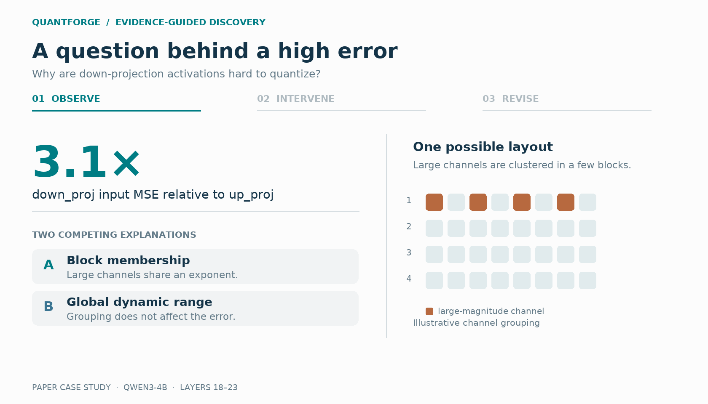
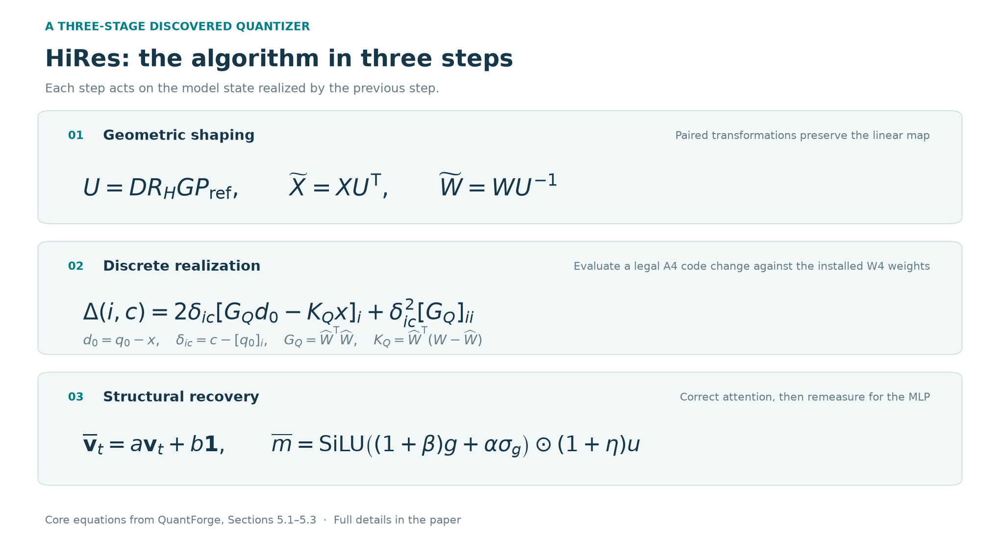
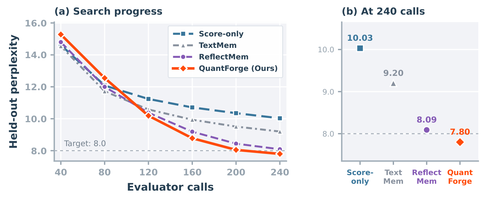
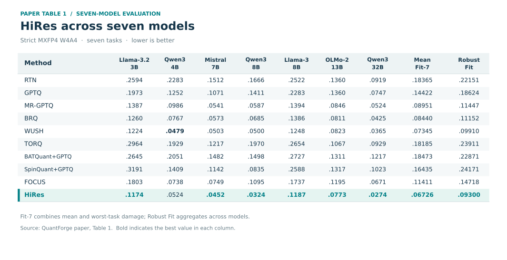
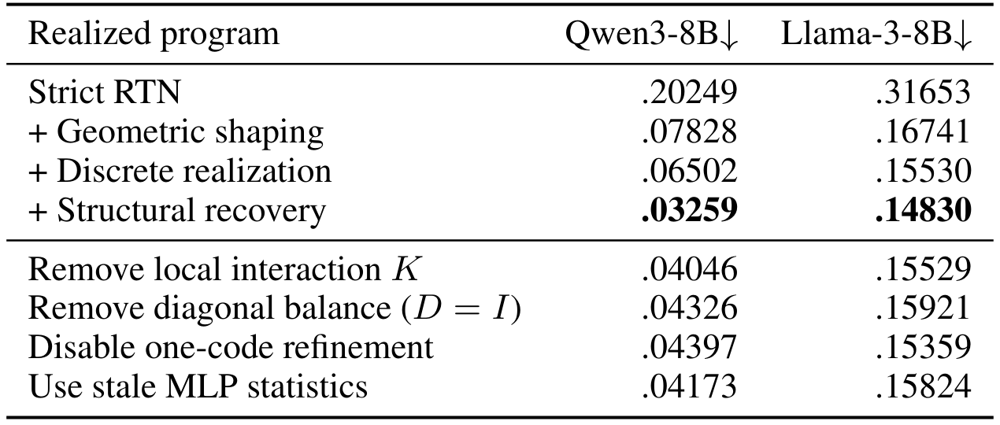

<h1 align="center">QuantForge</h1>

<p align="center">
  <strong>Discovering quantization algorithms through evidence-guided program evolution</strong>
</p>

<p align="center">
  Turn competing explanations into targeted experiments, verified code revisions, and the next algorithmic insight.
</p>

<p align="center">
  <a href="https://arxiv.org/abs/2609.34680"></a>
  <a href="https://www.python.org/"></a>
  <a href="LICENSE"></a>
</p>

<p align="center">
  <a href="https://arxiv.org/abs/2609.34680">Paper</a> ·
  <a href="#how-it-works">How It Works</a> ·
  <a href="#a-control-that-changed-the-next-design">Case Study</a> ·
  <a href="#the-discovered-algorithm-hires">HiRes</a> ·
  <a href="#paper-results">Results</a> ·
  <a href="#quick-start">Quick Start</a> ·
  <a href="docs/backends.md">Documentation</a>
</p>

<p align="center">
  Qiulin Shang · Zhoutong Wu · Jie Hu · Kun Yuan<br>
  Peking University
</p>

---

<div align="center">

https://github.com/user-attachments/assets/3faadda6-9e3e-49b8-845a-a8aa0a298df4

</div>

**QuantForge** discovers post-training quantization algorithms by combining AI-driven program evolution with controlled experiments. Starting from an initial program and an evaluator, it tests candidates, investigates why they work, and uses the evidence to guide the next revision.

In our [paper](https://arxiv.org/abs/2609.34680), QuantForge discovers **HiRes**, a hierarchical MXFP4 post-training quantization algorithm. Under a matched search budget, it reaches a held-out transfer target in **6 of 8 runs**, compared with **3 of 8** for reflection memory.

<p align="center">
  
</p>

## How It Works

QuantForge builds a search around a simple question: **what should the next program change, and what evidence supports that change?**

1. **Track programs and open questions.** Keep an executable frontier of useful candidates alongside a residual frontier of unresolved design questions.
2. **Test competing explanations.** Register predictions before execution and select the lowest-cost controls that distinguish them.
3. **Turn verdicts into code.** Use the experimental result to direct a successor, then check the changed computation with an execution probe and a task-specific response check.
4. **Measure again.** Evaluate the revised program and use its remaining errors to open the next question.

## A Control That Changed the Next Design

An evaluation score can show that a program works, but it does not necessarily explain **why**. Different explanations can suggest very different changes to the next program. QuantForge uses a controlled experiment to distinguish those explanations before choosing a direction.

Consider an example from the search on Qwen3-4B. In layers 18–23, the activation-quantization mean squared error at `down_proj` was **3.1 times** that at `up_proj`. In MXFP4, each block of 32 values shares a scale: a few large values can set the scale and make smaller values in the same block harder to represent. The search registered two possible explanations:

- **Block membership:** large channels are concentrated in a few blocks, so which channels share a scale matters.
- **Global dynamic range:** the overall range dominates the error, regardless of how channels are grouped into blocks.

To tell them apart, QuantForge shuffled the input channels and inversely reordered the weight columns. This preserves the layer's original function before quantization while changing which channels share a block. If block membership matters, spreading the large channels should increase the error; if global range dominates, the error should stay roughly the same.

<p align="center">
  
</p>

The error ratio rose from **3.1× to 4.6×**, supporting the block-membership explanation. QuantForge turned that verdict into a specific code change: identify the channels that drive each block's shared scale and equalize them. This successor improved the search-visible Qwen3-4B perplexity from **11.42 to 11.19**. Given the same parent and evidence, a free-reflection successor widened the scale search instead and reached **11.44**.

## The Discovered Algorithm: HiRes

The search discovers **HiRes**, a three-stage MXFP4 quantizer. Each stage addresses residuals measured on the model produced by the previous stage.

<p align="center">
  
</p>

## Paper Results

### Evidence-guided discovery

With the same **240-call search budget** and **eight paired seeds**, QuantForge achieves the strongest held-out result among the compared search methods:

<p align="center">
  
</p>

Search uses Qwen3-4B; transfer is measured on held-out Llama-3.1-8B WikiText-2. The search budget comprises 141 calls for new programs and 99 for controls and probes; held-out evaluations are separate.

### HiRes: a discovered MXFP4 quantizer

Across seven models and seven tasks, HiRes obtains the best **Robust Fit: 0.09300**, compared with 0.09910 for WUSH. It has the lowest Fit-7 on six of the seven models; WUSH leads on Qwen3-4B.

<p align="center">
  
</p>

<details>
<summary>Stage progression and ablations · paper Table 2</summary>
<p align="center"></p>
</details>

## Quick Start

Install QuantForge with Python 3.10 or newer:

```bash
git clone https://github.com/qiulin13145/QuantForge.git
cd QuantForge
python3 -m pip install -e .
```

Start a search with the included Block32 configuration and an authenticated [Codex CLI](https://github.com/openai/codex) proposer:

```bash
quantforge init runs/block32 --config examples/block32/config.json
quantforge step runs/block32
```

### Configure your search

To explore your own quantization design, use the [Block32 configuration](examples/block32/config.json) as a starting point and provide:

1. **An initial program:** a Python file with the function to evolve.
2. **An evaluator:** a command that scores candidates, checks the task contract, and verifies verdict-guided revisions.
3. **A configuration:** the objective, initial design question, function name, probe input, evaluation budget, and proposer and evaluator commands.

Point QuantForge to your configuration and run a round:

```bash
quantforge init runs/my-search --config path/to/config.json
quantforge step runs/my-search
```

Run `step` again to continue. The [backend protocol](docs/backends.md) describes the proposer and evaluator interfaces.

## Citation

If QuantForge is useful in your research, please cite:

```bibtex
@article{shang2026quantforge,
  title={QuantForge: Discovering Residual Decompositions for MXFP4 Post-Training Quantization},
  author={Shang, Qiulin and Wu, Zhoutong and Hu, Jie and Yuan, Kun},
  journal={arXiv preprint arXiv:2609.34680},
  year={2026}
}
```

## License

Released under the [MIT License](LICENSE).
