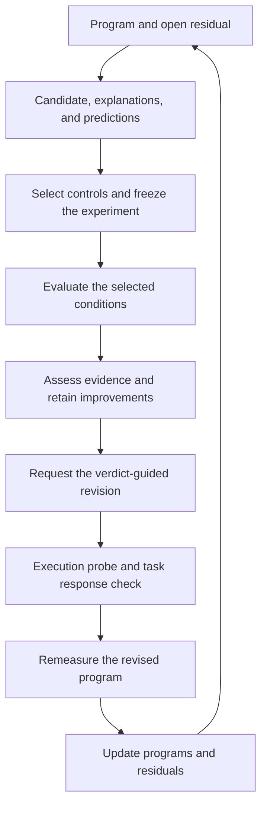

# Architecture

QuantForge connects executable programs, open design questions, and controlled
experiments in one search cycle. The code is organized around that cycle:
`search/` implements the method, `runtime/` executes and records its steps, and
`backends/` connects an external proposer.

## Code map

| Module | Responsibility |
| --- | --- |
| [`protocol.py`](../src/quantforge/protocol.py) | Typed records for programs, residuals, proposals, measurements, and workspace state. |
| [`schemas.py`](../src/quantforge/schemas.py) | JSON output schemas supplied to the proposer. |
| [`search/engine.py`](../src/quantforge/search/engine.py) | Round lifecycle: propose, freeze, evaluate, revise, verify, and remeasure. |
| [`search/controls.py`](../src/quantforge/search/controls.py) | Validate predictions and select the minimum-cost discriminating conditions. |
| [`search/verdicts.py`](../src/quantforge/search/verdicts.py) | Interpret evidence separately from program improvement and map verdicts to required responses. |
| [`search/prompts.py`](../src/quantforge/search/prompts.py) | Assemble the task and experimental context for each proposer phase. |
| [`runtime/backend_runner.py`](../src/quantforge/runtime/backend_runner.py) | Execute JSON backends, check evaluator responses, cache calls, and account for budget. |
| [`runtime/verification.py`](../src/quantforge/runtime/verification.py) | Check that the targeted function changes and the probe reaches changed code. |
| [`runtime/probe_worker.py`](../src/quantforge/runtime/probe_worker.py) | Run the function and collect its execution trace in a child process. |
| [`runtime/workspace.py`](../src/quantforge/runtime/workspace.py) | Initialize, lock, persist, and recover local search state. |
| [`backends/codex.py`](../src/quantforge/backends/codex.py) | Adapt an authenticated Codex CLI to the proposer protocol. |
| [`cli.py`](../src/quantforge/cli.py) | Expose initialization, stepping, status, and recovery commands. |

## One search round

[`run_round()`](../src/quantforge/search/engine.py) is the entry point for following
the implementation. A workspace lock covers the round. The controller resumes
its pending work or selects the first open residual and the program that owns it.

1. **Establish the parent measurement.** Evaluate the parent if it has no score.
2. **Design the experiment.** Request candidate source, competing explanations,
   and categorical predictions. The control selector distinguishes every pair of
   explanations using the primary condition and the least costly additional
   controls. Invalid designs receive feedback for up to three proposal attempts.
3. **Freeze and execute.** Record the parent, proposal, selected conditions, task
   contract, and evaluator identity before running the conditions.
4. **Interpret the evidence.** Determine both the explanation-level verdict and
   whether the candidate improves the objective. A useful candidate can be
   retained even when its explanation remains unresolved.
5. **Implement the response.** For verdicts other than `NO_EFFECT` and `UNSAFE`,
   request a revised program. Verify that the target function changes and that
   the execution probe reaches changed lines, then ask the evaluator to confirm
   the task-specific response.
6. **Remeasure and update.** Evaluate the revised program. If it does not regress
   relative to the parent, retain it and ask for the next residual using the new
   measurement. An unresolved original question remains open.

The workspace stores these objects as ordinary JSON dictionaries. The types in
`protocol.py` describe their fields; they do not introduce a separate serialized
representation. Earlier imports such as `quantforge.engine.run_round` continue
to resolve to the current implementation.

## Execution and persistence

Each proposer or evaluator is a command receiving one JSON request on stdin and
returning one JSON object on stdout. The controller provides the same contract and
parent context to the evaluator for every condition. Task-specific metrics and
validity checks belong to that evaluator.

Completed calls are cached by request and backend identity. Evaluator spending
is recorded before execution, and each completed call is saved atomically.
Resuming a round reuses matching results; interrupted calls require explicit
recovery. The [backend protocol](backends.md#recovery) describes the recovery
commands.

## Connecting a quantization task

The three files in [`examples/block32/`](../examples/block32/) show the boundary
between the search framework and a task:

- `baseline.py` supplies the initial executable program.
- `evaluator.py` generates inputs, executes programs, checks the quantization
  format, measures reconstruction error, and validates responses.
- `config.json` specifies the initial question, target function, probe input,
  contract, budget, and backend commands.

For another quantization design, provide the corresponding program, evaluator,
and configuration through the same [backend protocol](backends.md). The search
controller continues to organize the experiment and revision cycle. The
[paper protocol](paper-protocol.md) describes the experimental settings used in
the paper.
